# Drone2D-3D
## Single-Pass Drone Video to Accurate 3D Model Generation System

### Frontend Technical & Prototype Documentation

------------------------------------------------------------

## 1. Executive Summary

The Drone2D-3D system is designed to transform single-pass drone video footage into highly accurate, measurable 3D models. Traditionally, aerial surveying requires complex mission planning, cross-hatch flight patterns, and tedious manual photogrammetry processing. The core proposition of Drone2D-3D is to dramatically simplify this process by allowing a drone to perform a single video sweep over a site and automatically processing that footage into a 3D reconstruction.

The current implementation documented here is a **frontend prototype/simulation**. It represents the complete user interface, application state management, component architecture, and interaction design of the system. **Actual computer-vision reconstruction (Structure from Motion / Multi-View Stereo) is not yet executed by the frontend itself.** Instead, this frontend demonstrates the real-world workflow, using simulated progress states, mock processing metrics, and procedural/demo 3D geometries to validate the user experience and prepare for integration with a future processing backend.

------------------------------------------------------------

## 2. Problem Statement

Traditional 3D surveying and reconstruction present several significant barriers:
- **Manual Workflows**: Operators must juggle multiple specialized tools for flight planning, video extraction, photogrammetry, and 3D visualization.
- **Complex Processing**: Photogrammetry engines often require deep technical knowledge to configure correctly.
- **Time-Consuming Extraction**: Manually selecting the best frames from a drone video is tedious and prone to human error.
- **Accessibility**: Engineering-grade 3D measurement tools are rarely accessible to non-specialists or project stakeholders via a simple web interface.

**The Proposed Concept:**
Drone performs one flight pass → captures video → video is analyzed → useful frames are selected → visual features are extracted → features are matched → camera poses are estimated → sparse reconstruction → dense reconstruction → mesh generation → optimized 3D model → model visualization → measurements → export.

**Current Frontend vs Future Backend:**
- **CURRENT FRONTEND**: Responsible for visualization, workflow simulation, user controls, responsive UI state, 3D rendering of the resulting meshes/point clouds, and geospatial mapping.
- **FUTURE BACKEND**: Will handle the actual video processing, computer vision algorithms, heavy photogrammetry reconstruction, and mesh optimization via dedicated API workers.

------------------------------------------------------------

## 3. Project Objectives

The primary objectives of the Drone2D-3D frontend are:
- Provide a clear **single-pass drone survey workflow** interface.
- Implement an **automated reconstruction concept** dashboard that demystifies the CV pipeline.
- Deliver a **professional engineering interface** without relying on overly futuristic or distracting aesthetic tropes.
- Support **frame inspection** and spatial **flight-path visualization**.
- Allow users to monitor **reconstruction progress** across complex multi-stage pipelines.
- Provide a robust **3D model visualization** environment.
- Enable high-utility **measurements** (distance, area, volume).
- Support standard **model export** formats.
- Offer comprehensive **system/settings control**.
- Provide a complete architecture ready for **future real drone-video integration**.

------------------------------------------------------------

## 4. System Architecture

The architecture relies on a clear separation between the client-side visualization application and the future server-side heavy computation pipeline.

```text
       [ Real Drone Video ]
                |
                v
  [ Future Backend / CV Pipeline ]
   (Frame Extraction, SfM, MVS)
                |
                v
      [ API / Processing Layer ]
                |
                v
    [ Drone2D-3D Frontend (React) ]
                |
  +--------------------------------+
  |                                |
  +--> Dashboard (System Status)   |
  +--> Project (Pipeline Config)   |
  +--> Upload (Video Ingestion)    |
  +--> Reconstruction (Progress)   |
  +--> 3D Model (Viewer)           |
  +--> Map (Geospatial View)       |
  +--> Measurements (Analysis)     |
  +--> Export (Data Delivery)      |
  +--> Settings (App Preferences)  |
  +--------------------------------+
```

**Boundary Note**: The current frontend relies on a mock data layer. It utilizes simulated reconstruction states, procedural/demo 3D geometries, simulated export files, and mock processing metrics to represent how the frontend will behave once the API layer is fully integrated.

------------------------------------------------------------

## 5. Technology Stack

| Technology | Version | Role | Usage in Drone2D-3D |
| :--- | :--- | :--- | :--- |
| **React** | 19.2.8 | UI Framework | Core application framework. Enables component-based architecture and reactive UI updates. |
| **TypeScript** | 6.0.2 | Language | Provides strict typing for application state, geometry schemas, and API interfaces. |
| **Vite** | 8.2.2 | Build Tool | Development server and production bundler ensuring extremely fast HMR and optimized builds. |
| **Tailwind CSS** | 3.4.19 | Styling | Utility-first CSS framework used for all responsive layouts, theming (dark/light), and design system enforcement. |
| **Zustand** | 5.0.15 | State Management | Lightweight, unopinionated state manager used for app settings, reconstruction progress, and viewer state. |
| **React Router** | 7.18.3 | Routing | Manages client-side navigation between the different workspaces (Dashboard, Model, Map, etc.). |
| **Three.js** | 0.185.1 | 3D Engine | WebGL library underlying the 3D model viewer and measurement canvas. |
| **React Three Fiber** | 9.7.0 | 3D React Renderer | React wrapper for Three.js allowing declarative 3D scene graphs and componentized geometry. |
| **Drei** | 10.7.8 | 3D Helpers | Extension for R3F providing ready-made orbit controls, staging, and helpers. |
| **Lucide React** | 1.42.0 | Iconography | Consistent, professional vector icons used throughout the interface. |

------------------------------------------------------------

## 6. Frontend Architecture

The project structure is organized by technical concern and domain-specific workspaces:

```text
src/
├── assets/         # Static images, icons, and local demo 3D models
├── components/     # Reusable UI components
│   ├── common/         # Buttons, Cards, Badges, Progress Bars
│   ├── export/         # Format selectors, export progress panels
│   ├── layout/         # AppShell, Sidebar, TopBar, StatusBar
│   ├── map/            # FlightPathMap, LocationPanel, ImageStrip
│   ├── measurements/   # Canvas, Toolbar, History, Summary panels
│   ├── reconstruction/ # Pipeline visualization, stage indicators
│   ├── theme/          # ThemeToggle
│   ├── upload/         # Drag/drop zones, video preview
│   └── viewer/         # Viewer3D, ModelLayers, PointCloudControls
├── data/           # Mock data providers (flight paths, frames, metrics)
├── hooks/          # Custom React hooks (e.g., useTheme)
├── pages/          # Top-level route components (Dashboard, Project, etc.)
├── store/          # Zustand state stores (appStore, exportStore)
├── types/          # Global TypeScript interfaces
└── utils/          # Helper functions (math, measurement conversions, export formatting)
```

**Separation of Concerns**: UI components are strictly separated from global state management. Pages act as layout orchestrators that map Zustand store selectors to specific feature components.

------------------------------------------------------------

## 7. Application Shell

The Application Shell establishes the core layout of the engineering workstation:
- **Top Navigation**: Contains project identity, global actions, and the theme switch.
- **Sidebar**: Provides persistent, easily accessible navigation between all 8 core workspaces.
- **Main Workspace**: A scrollable content area reserved for the active route.
- **System Status Bar**: A persistent bottom bar that communicates processing status, environment telemetry, and backend connectivity.

This layout is highly appropriate for professional geospatial applications because it maximizes the central screen real estate for maps and 3D viewers while keeping complex navigation and system telemetry predictable and out of the way.

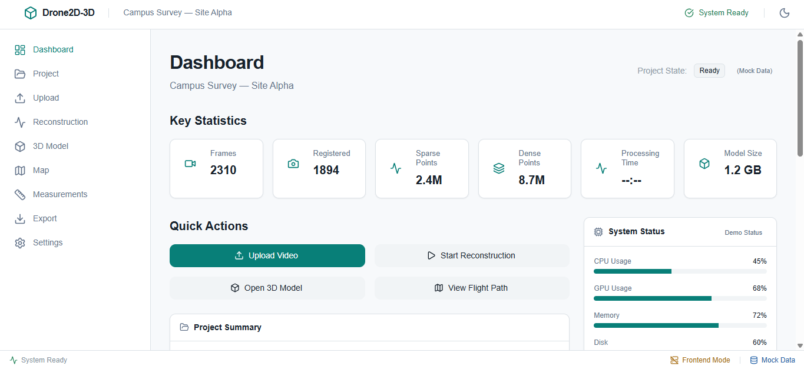

------------------------------------------------------------

## 8. DASHBOARD

The Dashboard serves as the central command center for the project. 

Key Metrics & Features:
- **Project Summary & Video Info**: Displays the canonical state of the uploaded video (e.g., duration, resolution, size).
- **Frame Statistics**: Tracks how many frames were extracted vs. registered.
- **Sparse & Dense Points**: Represents the complexity of the generated point cloud.
- **Reprojection Error**: A critical photogrammetry metric representing camera calibration accuracy.
- **System & Reconstruction Status**: Summarizes pipeline progress and hardware simulation status.

**Technical Metric Example: Reprojection Error**
1. **Meaning**: The pixel distance between a projected 3D point and its actual measurement on the 2D image.
2. **Importance**: Lower values (typically < 1.0px) indicate a highly accurate mathematical reconstruction.
3. **Future Backend**: Calculated by the SfM (Structure from Motion) solver during bundle adjustment.
4. **Current Prototype**: Represented as a static mock value (e.g., `0.42 px`) to validate UI thresholds and quality indicators.

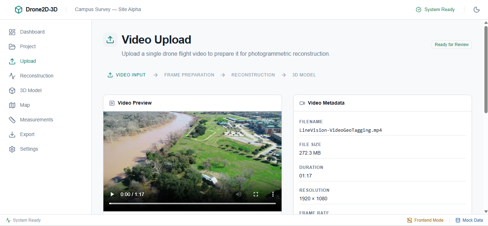

------------------------------------------------------------

## 9. PROJECT WORKFLOW

The Project page visualizes the complex computer vision pipeline that transforms raw video into a 3D model.

| Stage | Technical Operation | Input | Output | Frontend Representation | Future Backend |
| :--- | :--- | :--- | :--- | :--- | :--- |
| **Video Analysis** | Parse metadata and framerate | MP4 Video | Video Info | Simulated progress bar | FFprobe/OpenCV analysis |
| **Frame Selection** | Extract non-redundant frames | MP4 Video | JPG/PNG images | Frame count mock | OpenCV blur detection |
| **Feature Extraction** | Detect keypoints (e.g., SIFT/ORB) | Images | 2D Features | Simulated log events | GPU-accelerated CV |
| **Feature Matching** | Match features across frames | 2D Features | Feature tracks | Matches count mock | FLANN / KNN matching |
| **Camera Pose** | Estimate camera positions | Feature tracks| Camera matrix | Simulated log events | Essential matrix solve |
| **Sparse Recon.** | Triangulate initial 3D points | Poses + Tracks| Sparse Cloud | Sparse point count | Bundle Adjustment (SfM) |
| **Dense Recon.** | Depth map generation | Sparse Cloud | Dense Cloud | Dense point count | Multi-View Stereo (MVS) |
| **Mesh Generation**| Surface reconstruction | Dense Cloud | 3D Mesh | Face/Vertex count | Poisson / Delaunay |
| **Mesh Optimization**| Decimation & texturing | 3D Mesh | Final Model | Completion state | UV mapping & reduction |

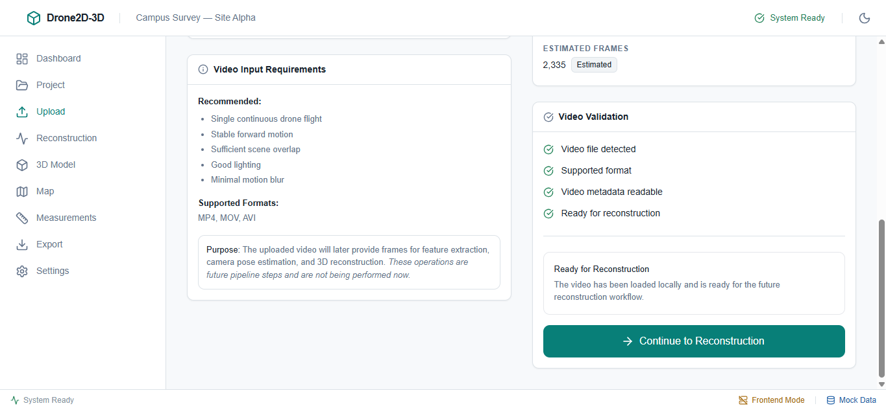

------------------------------------------------------------

## 10. VIDEO UPLOAD

The Upload page handles the initial ingestion of the drone footage.
- **Features**: Drag-and-drop zone, file validation, video preview thumbnail, and metadata parsing (duration, resolution, framerate, estimated frame count).
- **Real-world Workflow**: Real Drone Video → Upload → Video metadata extraction → Frame sampling → Backend processing.

**Important**: The current frontend calculates mock metadata based on a successful browser-side file read, but does not transmit the MP4 to an active processing server.

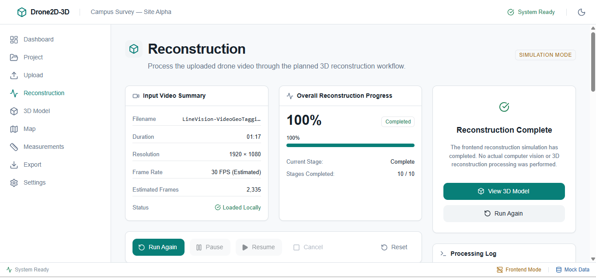

------------------------------------------------------------

## 11. RECONSTRUCTION WORKSPACE

The Reconstruction workspace provides granular control and monitoring over the processing pipeline.
- **Controls**: Start, pause, resume, cancel, reset, run again.
- **Monitoring**: Current active stage, global progress percentage, and a live terminal-style processing log.
- **Current Simulation**: The frontend uses `setInterval` timers in `useReconstructionStore` to simulate stage progression, emitting mock log lines to demonstrate UI reactivity.
- **Future Implementation**: A backend worker will execute the actual CV algorithms. The frontend will open a WebSocket connection to receive real-time progress events and streaming stdout logs from the compute cluster.

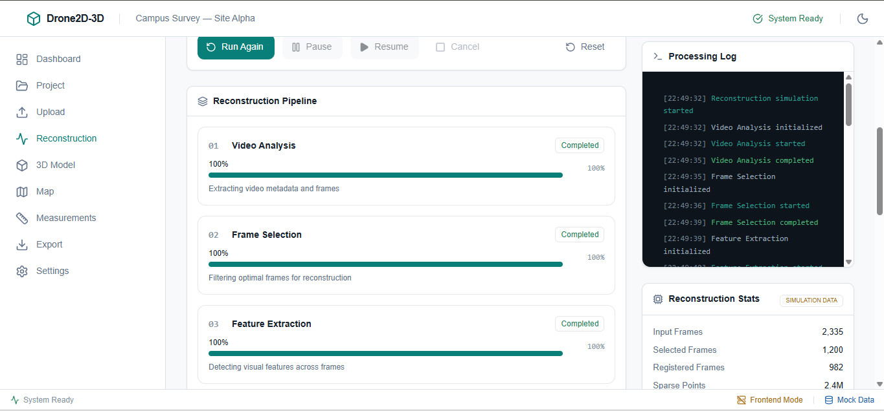

------------------------------------------------------------

## 12. MAP / FLIGHT PATH

The Map workspace grounds the reconstructed data in real-world geospatial coordinates.
- **Features**: Survey boundary overlay, flight path rendering, takeoff points, selectable waypoint nodes, zoom/pan controls, and an image strip representing drone frame captures at specific locations.
- **Current Implementation**: A bespoke SVG/mock map implementation designed to visually mimic a satellite view with overlay vectors.
- **Real-world Implementation**: Will consume actual Drone GPS telemetry (e.g., from EXIF data or flight logs) to plot the flight path dynamically via a library like Mapbox GL JS or Leaflet.
- **Utility**: Essential for verifying flight coverage, troubleshooting reconstruction gaps (e.g., identifying areas where the drone turned too quickly), and spatial verification of the site.


------------------------------------------------------------

## 13. DRONE FRAME INSPECTION

Accessible from the Map workspace, this feature allows users to inspect the individual frames extracted from the video.
- **Features**: Frame thumbnails, metadata, capture timestamps, and quality indicators linked to specific map waypoints.
- **Utility**: Allows engineers to identify blurry frames, areas with poor overlap, or unsuitable views (e.g., looking into the sun) that might compromise the 3D model.
- **Future Integration**: Will fetch actual extracted frames generated by the backend's frame-sampling step.

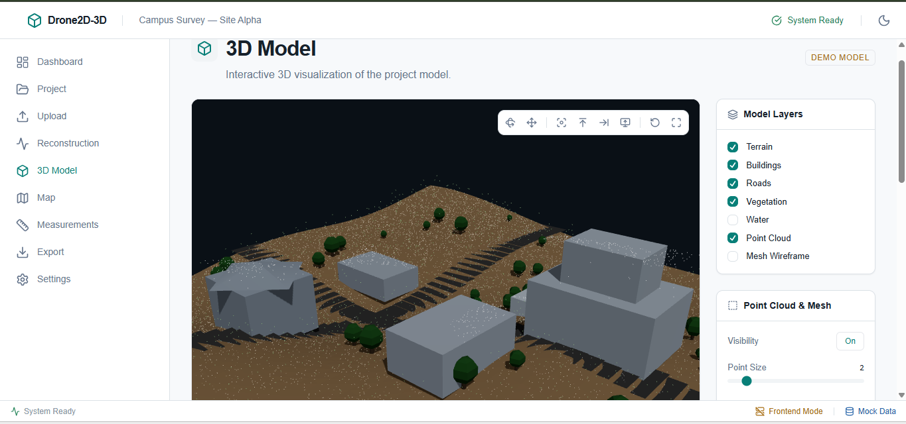

------------------------------------------------------------

## 14. 3D MODEL VIEWER

The heart of the application, rendering the final output.
- **Technology**: Built using Three.js and React Three Fiber.
- **Controls**: Orbit, pan, zoom, reset, fit-to-screen, and orthogonal camera views.
- **Layers**: Toggles for Terrain, Buildings, Roads, Point Cloud, Mesh, and Wireframe.
- **Future Real-World Pipeline**: Dense Point Cloud → Mesh → Texture → GLB export → Frontend Viewer.
- **Current State**: The viewer uses a procedural/demo Box/Plane geometry to represent the model space, ensuring the UI and camera controls are fully functional while waiting for backend GLB integration.

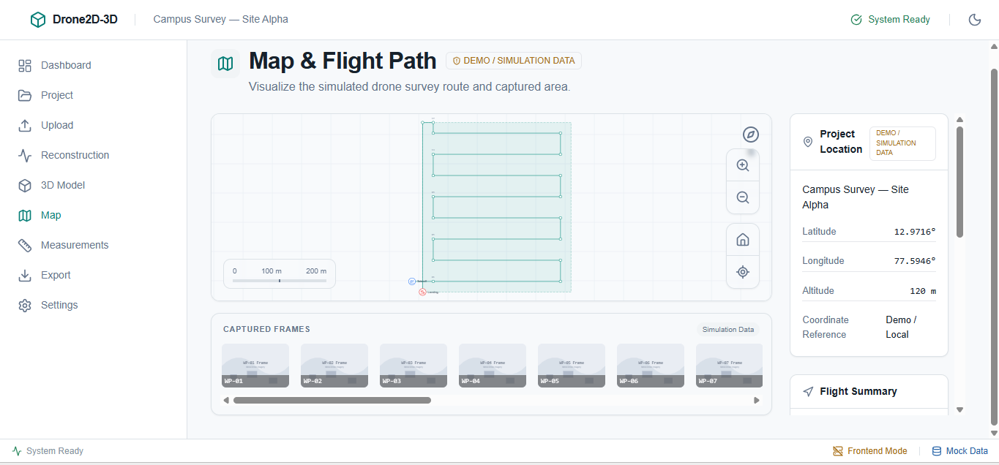

------------------------------------------------------------

## 15. POINT CLOUD VISUALIZATION

A point cloud is a massive set of data points in space, generally representing a 3D shape or object, generated here by the Multi-View Stereo (MVS) algorithm.
- **Why Density Matters**: Higher point density yields higher resolution meshes but requires significantly more memory to render.
- **RGB/Classification**: Points contain color data from the drone video and can be mathematically classified (e.g., ground vs. vegetation) for advanced filtering.
- **Current Controls**: Point size adjustments and density sliders built into the viewer UI.

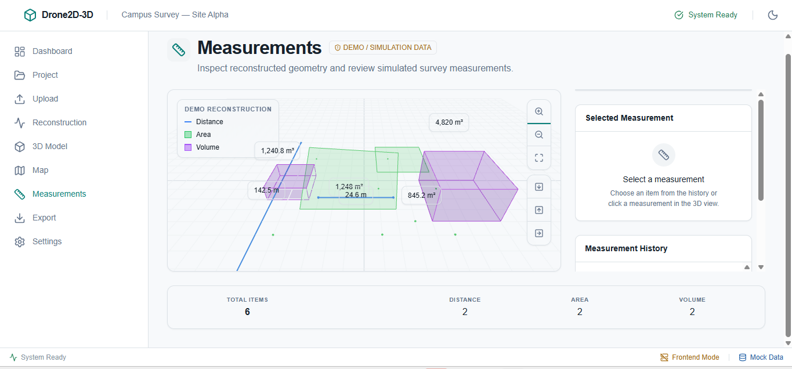

------------------------------------------------------------

## 16. MODEL QUALITY INDICATORS

The frontend displays key quality metrics:
- **Camera Registration**: Percentage of extracted frames successfully positioned in 3D space.
- **Point Density / Vertices / Faces**: Measures of geometric resolution.
- **Dimensions**: Physical bounds of the reconstructed site.
- **Source**: These are currently powered by the `mockModel` data source, but will eventually map directly to the backend's photogrammetry report output.

------------------------------------------------------------

## 17. MEASUREMENTS

The Measurements workspace transforms the 3D model from a visualization into an engineering tool.
- **Features**: Tools for Distance, Area, and Volume. Includes a measurement history sidebar, unit toggles (metric/imperial), and interactive 3D highlighting.
- **Real-World Usage**:
  - *Distance*: Road widths, equipment spacing.
  - *Area*: Roof surface area, agricultural field boundaries.
  - *Volume*: Stockpile estimation, earthwork calculations.
- **Implementation**: Currently uses prototype geometry to simulate raycasting and calculation math. Will execute identical mathematics against real loaded GLB meshes.

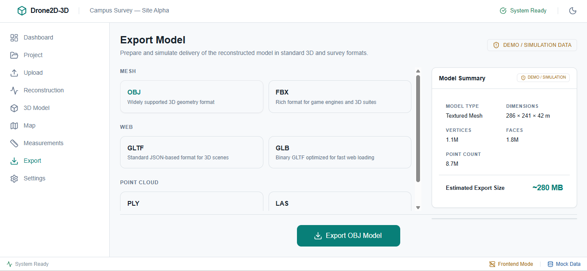

------------------------------------------------------------

## 18. EXPORT

The Export page allows users to download the final data for use in external CAD/GIS software.
- **Supported Formats**: OBJ, PLY, LAS, GLTF, GLB, FBX.
- **Consumer Use Cases**:
  - *OBJ/GLB*: General 3D software (Blender, Unity).
  - *LAS*: Professional GIS/LiDAR software (ArcGIS, CloudCompare).
  - *PLY*: Point cloud viewers.
- **Features**: Contextual settings (texture resolution, point density), progress simulation, and history tracking.
- **Current State**: Generates simulated/demo browser-native Blobs for download. Does not perform real format conversion.

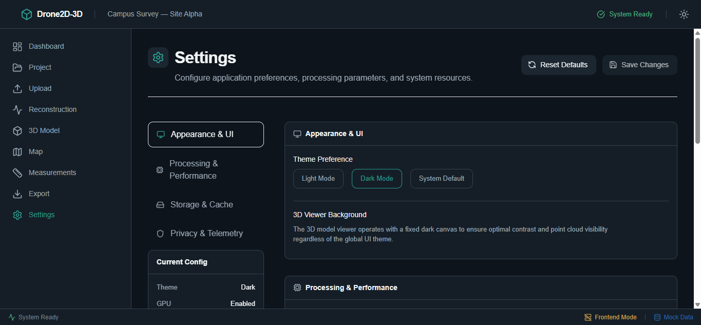

------------------------------------------------------------

## 19. SETTINGS

A comprehensive interface for application preferences.
- **Appearance**: Light Mode, Dark Mode, System Default. Note: The 3D viewer intentionally maintains a fixed dark canvas for contrast against point clouds.
- **Processing**: Simulated GPU acceleration toggles and memory targets.
- **Storage**: Cache size limits and auto-save behaviors.
- **Privacy**: Telemetry sharing controls.
- **Functionality**: Backed by a robust Zustand persistent store, ensuring user settings survive browser reloads. Features a smooth-scrolling sticky-header layout.

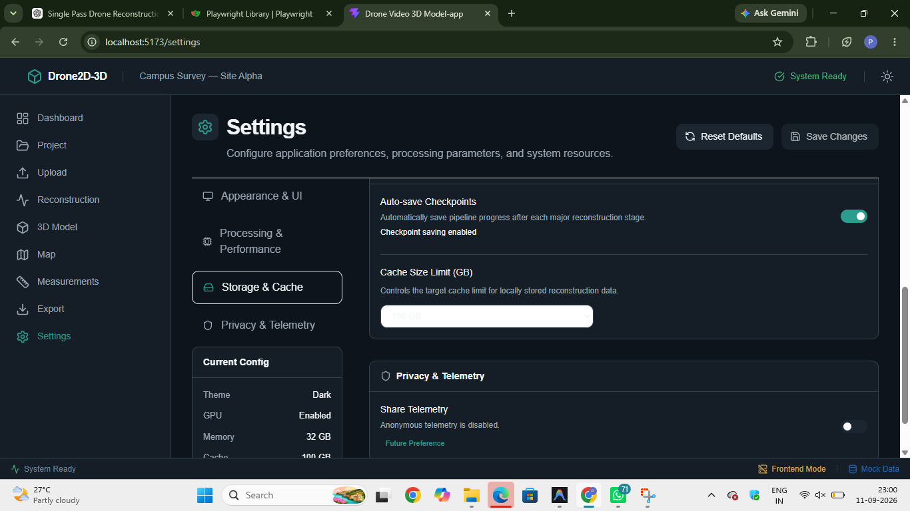

------------------------------------------------------------

## 20. LIGHT AND DARK THEMES

The application strictly enforces a professional engineering aesthetic across both themes.
- **Design System**: Uses carefully constructed Tailwind CSS variables (`bg-background`, `text-primary`, `border-border`) to ensure maximum readability and contrast.
- **Aesthetic**: Avoids neon, glowing, or "cyberpunk" tropes in favor of clean, structural interfaces.


------------------------------------------------------------

## 21. RESPONSIVE DESIGN

The UI is built to gracefully degrade across viewport sizes.
- **Mobile (<768px)**: Sidebars collapse into hidden menus, grid layouts stack vertically, and the 3D viewer takes over available vertical height.
- **Desktop (1024px+)**: Maximizes horizontal space, maintaining persistent navigation and split-panel workspaces (e.g., Map + Frame Inspector side-by-side).


------------------------------------------------------------

## 22. STATE MANAGEMENT

The architecture relies on specialized Zustand stores:
- **`appStore`**: Manages global UI state, theme preferences, processing settings, and canonical video metadata. Uses local storage persistence.
- **`useReconstructionStore`**: Manages the highly transient state of the simulation (progress %, current stage, live logs).
- **`useExportStore`**: Tracks export history, file generation statuses, and downloadable mock blobs.

State synchronization ensures that if a video is "uploaded" in the Upload workspace, its metadata is instantly reflected in the Dashboard and Project workspaces without duplicate data.

------------------------------------------------------------

## 23. MOCK DATA VS REAL DATA

| Feature | Current Prototype Data | Future Real Source |
| :--- | :--- | :--- |
| **Video Metadata** | Mock metadata generated on file select | Actual extracted MP4 header data |
| **Recon. Progress** | Frontend `setInterval` simulation | Backend WebSocket processing events |
| **Point Cloud** | Procedural demo geometry | Actual MVS output file |
| **Mesh** | Procedural demo geometry | Reconstructed geometry (Poisson) |
| **Flight Path** | Mock waypoint arrays | Extracted drone telemetry/GPS logs |
| **Measurements** | Prototype geometry calculations | Calibrated 3D model raycasting |
| **Export** | Demo Blob files | Actual backend-converted model files |

------------------------------------------------------------

## 24. REAL DRONE VIDEO — END-TO-END WORKFLOW

When integrated with a real CV backend, the workflow operates as follows:
1. **Upload**: User provides a single MP4 from a drone sweep.
2. **Video Analysis**: Backend extracts frame rate and camera sensor properties.
3. **Frame Extraction**: Backend pulls distinct images to guarantee overlap without redundancy.
4. **Feature Detection**: Algorithms (SIFT/ORB) find high-contrast points in every image.
5. **Feature Matching**: Cross-references points between images to identify common features.
6. **Camera Pose Estimation**: Calculates the exact 3D position where each photo was taken.
7. **Structure from Motion (SfM)**: Generates a Sparse Point Cloud by triangulating features.
8. **Multi-View Stereo (MVS)**: Generates a Dense Point Cloud by performing depth mapping.
9. **Mesh Generation**: Wraps the dense points into a solid polygonal surface.
10. **Texture Processing**: Projects the original photo colors onto the mesh.
11. **3D Viewer / Measurements**: Frontend downloads the resulting model for interaction.

------------------------------------------------------------

## 25. REAL-WORLD USE CASES

Once fully implemented, the system supports:
- **Construction**: Volumetric analysis of stockpiles; terrain inspection for site prep.
- **Surveying**: Fast terrain mapping without placing physical ground control points (GCPs).
- **Agriculture**: Field inspection and slope analysis for drainage.
- **Infrastructure**: Inspection of bridges and utility corridors from safe drone distances.
- **Disaster Assessment**: Rapid volumetric estimation of debris or damaged structures.

------------------------------------------------------------

## 26. PROTOTYPE DEMONSTRATION WORKFLOW

To fully demonstrate the current frontend prototype:
1. Start application and open **Upload**. Select any video file (simulated).
2. Navigate to **Dashboard** to view updated video metadata.
3. Open **Reconstruction**, click "Start Processing", and watch the simulated logs and progress bars.
4. Open **Map**, zoom into the flight path, and click waypoints to inspect mock frames.
5. Open **3D Model** to interact with the Three.js orbit controls and layer toggles.
6. Open **Measurements**, select a tool, and verify the UI updates.
7. Open **Export**, select 'GLB', click 'Start Export', wait for completion, and click 'Download'.
8. Open **Settings**, change the Theme to Dark Mode, and verify the UI updates globally.

------------------------------------------------------------

## 27. HOW TO INSTALL

**Prerequisites:**
- Node.js (v18 or higher recommended)
- npm (v9 or higher recommended)

**Installation & Execution:**
```bash
# Install dependencies
npm install

# Start the Vite development server
npm run dev

# Build for production
npm run build
```
